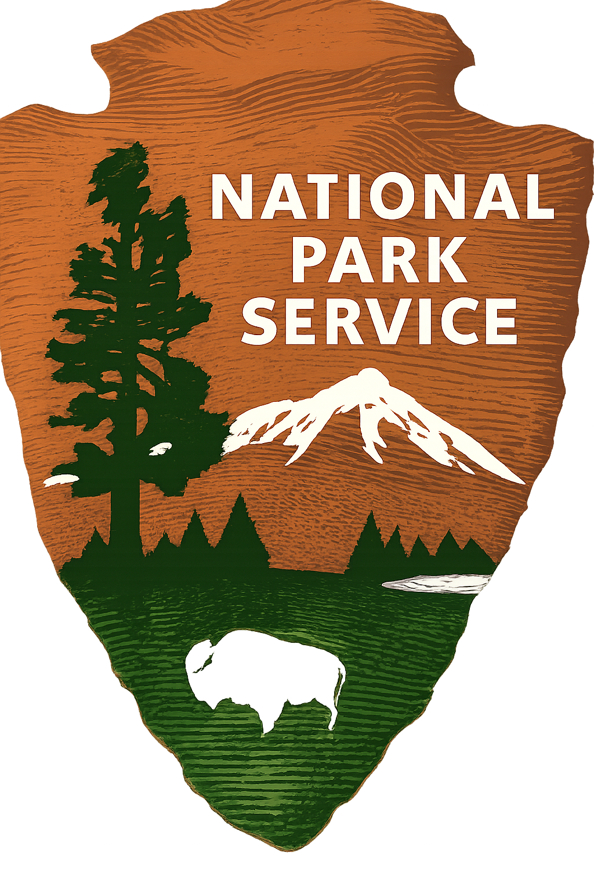
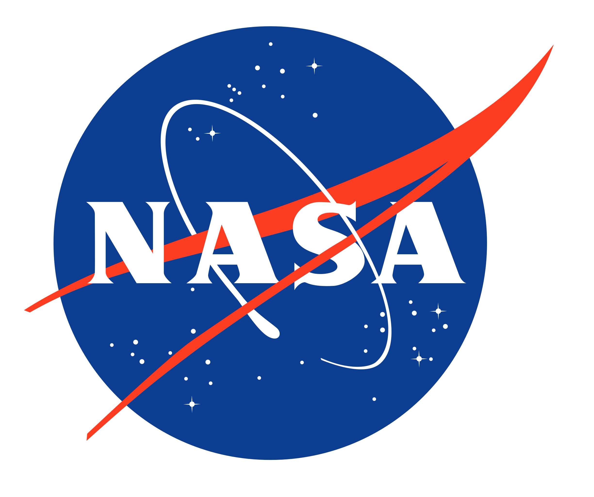
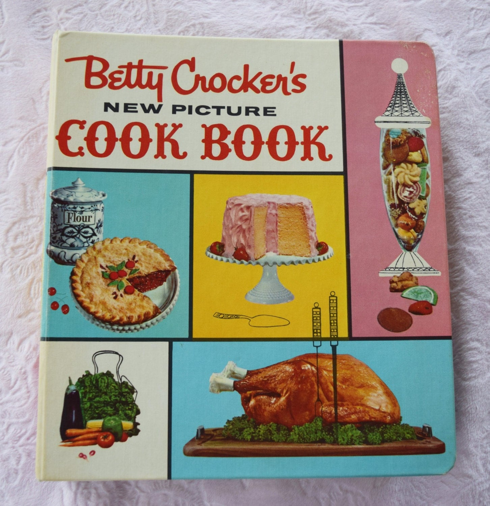
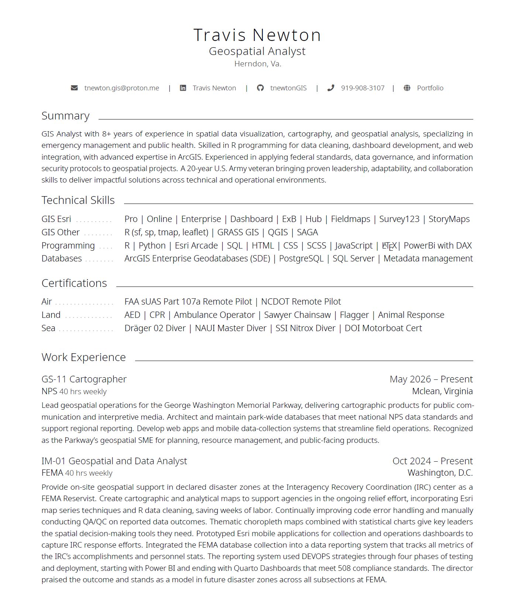
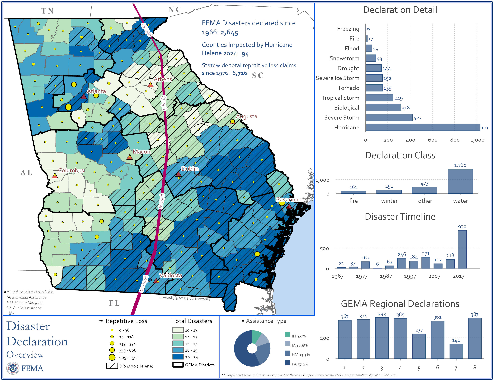

```{r echo=FALSE, output=FALSE, warning=FALSE}
if (require("pacman", quietly = TRUE)) {
  print("Pacman has been installed.")
} else {
  print("Package is not installed. Installing Pacman now....")
  install.packages("pacman")
}

#Packages to be loaded
pacman::p_load("janitor", "tidyverse", "here", "readxl", "tigris", "sf", "readODS", "rnaturalearth", "ggspatial", "ggrepel", "ggimage", "ggtext")

```

## House keeping {background-image="white_contour.jpg" background-opacity=".15" background-size="contain" background-repeat="repeat"}

- Ask any question throughout

  - One presentation
  - Will stop on slide-"N" when close to time, pick up again next round

- Reach out with questions

- Masters not a PhD

  - I'm approachable

- Currently on seasonal with NPS until 14 Nov 26

- Past classes mostly undergrad - geared much differently

  - pep talk from coach

{.top-right width="5%"}

## Agenda {.r-fit-text .smaller background-image="white_contour.jpg" background-opacity=".15" background-size="contain" background-repeat="repeat"}

**NASA DEVELOP**

::: fit-box
- Meeting and discussions 3 x 45min-1hr sessions
- Section 01 *`pg.1-15`*
  - Introductions, DEVELOP tips
  - Career paths
  - Getting a job
- Section 02 *`pg.15-21`*
  - Lessons learned
  - Workplace Battle Rhythm
  - Projects at jobs (NPS)
- Section 03 *`pg.22-28`*
  - Projects (FEMA, Esri)
  - Misc
:::

## About Me {background-image="white_contour.jpg" background-opacity=".15" background-size="contain" background-repeat="repeat"}

[**From**]{.underline}

- Pacific Northwest (PNW)
- Resettled East Coast (NC, VA, GA) after military career
- Did a 3yr Masters Degree NCSU, applied to one PhD in UNM on a Navajo health project
  - Alternate list, not enough research
- DEVELOP'R Summer 2020 (covid remote)

## Location Employment {background-image="white_contour.jpg" background-opacity=".15" background-size="contain" background-repeat="repeat"}

```{r label=read_sf, echo=FALSE, output=FALSE, warning=FALSE}
usa <- st_read(here("spatial/conus_usa.shp"))
job <- readODS::read_ods(here("data/jobs.ods")) %>% clean_names()

job_s <- job %>% slice(1:(n()-1)) %>% 
  mutate(map_label = str_to_title(map_label),
         long_img = x - 1.5,
         lat_img = y + 1.5,
         long_lab = x + 2.0,
         lat_lab = y - 0.45,
         label_text = paste0(map_label, "<br>", str_to_title(city),", ", str_to_title(state)))

job_s <- job_s %>% 
  mutate(long_img = if_else(name == "esri", x + 1.5, long_img),
         lat_img = if_else(name == "esri", y - 1.5, lat_img),
         long_lab = if_else(name == "esri", x - 2.0, long_lab),
         lat_lab = if_else(name == "esri", y + 0.45, lat_lab))

```

::::: columns
::: {.column width="20%"}
[Jobs]{.underline}

- **U.S.Army**

- Global Trek Adventures

- DEVELOP

- Esri

- **Esri**

- *NPS*

- *USFS*

- *FEMA Reserves*

- *NPS*
:::

::: {.column width="80%"}
```{r label=plot_sf, echo=FALSE, warning=FALSE}

plot_s <- ggplot() +
  geom_sf(data = usa, fill = "white", color = "gray70") +
  coord_sf(expand = TRUE) +
  geom_point(data = job_s, aes(x = x, y = y), color = "red", size = 2) +
  geom_segment(data = job_s,
               aes(x = x, y = y, xend = long_img, yend = lat_img),
               arrow = arrow(length = unit(0.2, "cm")),
               color = "black") +
  geom_image(data = job_s, aes(x = long_img, y = lat_img, image = logo), size = 0.07) +
  # geom_richtext(data = job_s,
  #               aes(x = long_lab, y = lat_lab, label = label_text),
  #               fill = "#666666", alpha = 0.5,
  #               color = "black",
  #               label.color = NA,
  #               hjust = 1,
  #               vjust = 1,
  #               size = 3)
  labs(title = "Employment Location",
       caption = "Government Careers") +
  theme_minimal() +
  theme(axis.text = element_blank(),
        axis.ticks = element_blank(),
        axis.title = element_blank(),
        panel.grid.major = element_blank(),
        panel.grid.minor = element_blank(),
        plot.background  = element_rect(fill = "#D9E3F1", color = NA),
        plot.title   = element_text(margin = margin(t = 0, b = 0)),
        plot.caption = element_text(margin = margin(t = 0, b = 0)),
        plot.margin  = margin(0, 0, 0, 0))

plot_s

```
:::
:::::

## About You {#about-you background-image="white_contour.jpg" background-opacity=".15" background-size="contain" background-repeat="repeat"}

::::: columns
::: {.column width="75%"}
Tell me about yourself

1.  Degree?

2.  Where you from (country, state, city)?

3.  3a. Do you have any special skills? (eagle scout, baseball player, etc)

    3b. Do you have a fun fact that's interesting about you?

4.  Describe your project?

5.  What are your ambitions after DEVELOP?

6.  How will DEVELOP get you where you need to go?
:::

::: {.column width="25%"}
{fig-align="right"}
:::
:::::

::: callout-note
## Elevator Pitch

These questions can help you with an elevator pitch for your time at NASA \[*Neda...great portfolio page!\]*
:::

## DEVELOP {background-image="white_contour.jpg" background-opacity=".15" background-size="contain" background-repeat="repeat"}

Tips for Success

- Single focus (water, tree, landslide, etc)....`Be Generic`
- Use a GIT repository
- Pick one method and stick with it (R/SF) or (Python/Esri )
- Lean on teams capabilities, don't discredit younger personnel
- Best one line advice from Develop...**"I just thought like a computer"** reference a change detection method
  - raster calc vs map algebra vs pro toolbox

## DEVELOP - R {background-image="white_contour.jpg" background-opacity=".15" background-size="contain" background-repeat="repeat"}

- Divide and Conquer
  - Data (tidyverse) = everyone
  - Reports (quarto/markdown/latex/typst)
  - Plots (ggplot2 and plotly)
  - Maps (sf, leaflet)
  - Application Requirement? (limited time)
    - Yes - Quarto static dashboard
    - No - Shiny functions (bslib, html, css)

::: callout-tip
## Cartography

Don't worry about *cartography*. DEVELOP conducts studies of natural/human science phenomenon using EOS. Simple maps with associated graphs and tables or an interactive app are better.
:::

{.absolute top="30%" right="0%" width="25%"}

## Break {background-image="white_contour.jpg" background-opacity=".15" background-size="contain" background-repeat="repeat"}

Next:

- From academia to the workforce

## Career Questions

Whats important to you?

- Live/Work Location (whats drive time)
- 401k
- Pension ?
- Field work. What %
- Longevity at company or agency
- Teamwork or individual

::: callout-warning
## Golden Handcuffs

The invisible prison cell of 3-5 years preventing an employee from leaving the company or forfeit 401k contributions by the employer.
:::

## Sector Desired {background-image="white_contour.jpg" background-opacity=".15" background-size="contain" background-repeat="repeat"}

Sectors drive job opportunity

- GIS core tasks

  - Esri Desktop & Apps

- Data Analytics

- Scientific Discovery

- Industries - Commerce, Health, Petroleum

Job Sites

- <https://www.mygisjobs.com>

## Career Paths {background-image="white_contour.jpg" background-opacity=".15" background-size="contain" background-repeat="repeat"}

- Government Standard (city, state, federal)
  - DOT, NCR, Realestate, USFW, USBR, USDA
- Government Scientific
  - NOAA, USGS, NASA, CIA, NGA, FBI Crimelab
- Government one-offs
  - Cemetery (Arlington, VA), Military base (NR), Wildfire, BIE
- Civilian
  - Esri, Petroleum, Corp Business, Healthcare, Intel
- Civilian one-offs
  - PCT/AT Hiking, PeaceCorp island Hopping, Disney, Lego, Samaritans Purse

## Landing a Job {background-image="white_contour.jpg" background-opacity=".15" background-size="contain" background-repeat="repeat"}

Pro

- Each degree pays a little more and allows entry into a position

  - BS: GS-7, MS: GS-9/11, PhD: GS-11/12

Con

- **PhDs start career 2-7 years after counterparts**

- Companies prefer undergrad to masters. cheaper, longevity

  - Example: Undergrad boss, 20yrs in sector over me, new everything python and esri.

Pay yo' Dues

- 1yr probation period for each grade. Willing to move and jump ship (agency). There is no blackballing anymore.

## Application Success {background-image="white_contour.jpg" background-opacity=".15" background-size="contain" background-repeat="repeat"}

- Portfolio (yes)

- Project Showcase (yes)

- *Resume 2page vs CV 10page*

- Business Card

  - Front - contact info

  - Back - QR scan code, portfolio / project

- Networking

  - Build out Linkedin, great ideas, job & postdoc opportunity

  - Don't - let in non-industry, people you haven't met, or people without pics

## Break {background-image="white_contour.jpg" background-opacity=".15" background-size="contain" background-repeat="repeat"}

Next:

- Lessons learned
- Work at NPS

## Lessons Learned {background-image="white_contour.jpg" background-opacity=".15" background-size="contain" background-repeat="repeat"}

::::: columns
::: {.column width="85%"}
- Project Hours
  - Projects always req more hours then given
  - Eat the hours your first year or two AND Cook the books
- Type of project
  - Bill out hours in a breakdown
  - Add 20% to each category
- QA/QC Everything
  - Esri large project GEMA road networks
    - **Crawl -\> Walk -\> Run**
    - Manual Calc -\> Visualize -\> Code -\> toolbox
    - Once code works; **Optimize** (functions, dictionary, loops, etc)
- Not all divisions play well (IT - GIS - EM - Police - Fire - NR) (Trees - Maintenece - RM)
:::

::: {.column width="15%"}

:::
:::::

## Useful Items {background-image="white_contour.jpg" background-opacity=".15" background-size="contain" background-repeat="repeat"}

- Organized browser toolbars
- Use Esri toolbox - then send to python window
- Build GPTools for repeat work
- Balance code project vs. cartography or get done now
- Integrate R for reporting (Tree docx vs Tree txt)
- Esri products DO NOT like non-spatial data
  - Combine flat data and spatial data (without issues)
- Little to none: *QGIS, Grass, Blender, UAV*

::: callout-tip
## Favorite Toolbar

Once employed, 90% of work done from employee computer. Export toolbar to GITHUB and clone to personal computer(s).
:::

## Break {background-image="white_contour.jpg" background-opacity=".15" background-size="contain" background-repeat="repeat"}

Next:

- Work at NPS

## Battle Rhythm {background-image="white_contour.jpg" background-opacity=".15" background-size="contain" background-repeat="repeat"}

- Schedules = 5/4/9 or 4/10 or 5/8
- Meetings 2-8 hours a week
  - 1hr drive, 2hr meet, 1hr drive (twice)
  - Regular customer meets, try to stack - avoid large gaps
  - Training, webinars
- Morning: 10-60 min
  - Coffee, Spotify, Email, MSTeams, **LinkedIn**, Timesheet + ExcelTimesheet
- Data or App update, fix, check
  - power automate
- Actual GIS project work

## Work Breakdown {background-image="white_contour.jpg" background-opacity=".15" background-size="contain" background-repeat="repeat"}

Most Cases (NPS, ESRI) : GIS Core

- 50% Collection and Reporting

- 20% Database Management

- 10% Cartography

- 10% Analysis

- 10% Admin

NPS Region +

- DOGE Reshuffle. Assets sit at Regions or DOI

Other NPS

- Shenandoah: physical scientist biologist, environmental scientist

  - Field collection/observations. reports, analysis (R)

## Current Openings {background-image="white_contour.jpg" background-opacity=".15" background-size="contain" background-repeat="repeat"}

- Hydrologist (water source coordinator) - Bureau of Indian Affairs (Multiple States - OR, WA, SD, MN, OK)

- Hydrologist - Bureau of Reclamation (Albuquerque, NM)

- Research Ecologist Statistician - Smithsonian (Front Royal, VA)

- Airforce Hydrologist - Airforce (Kelly AFB, TX)

- Interdisciplinary (Hydraulics / Hydrologist) - Army Corp of Engineers (New Orleans, LA)

- Ecologist - National Park Service (Grand Lake, CO)

## NPS {background-image="white_contour.jpg" background-opacity=".15" background-size="contain" background-repeat="repeat"}

[Examples]{.underline}

- Static maps

- gptool vs rscript

- Tree App 400hr project / 2 = 200hr

  - Total Tree Reporting Evaluation System (TTRES)

- Typical apps

  - GIS Request

  - Issue Tracker

  - Lamp Tracker

  - 4th Jully

## Break {background-image="white_contour.jpg" background-opacity=".15" background-size="contain" background-repeat="repeat"}

Section 03

Next:

- FEMA Projects
- Misc

## Resumes {background-image="white_contour.jpg" background-opacity=".15" background-size="contain" background-repeat="repeat"}

::::: columns
::: {.column width="75%"}
- Resume builder
  - Federal vs Civilian
    - Requires: `location, duty title, hours, salary`
  - Generic Resume and Cover Letter
    - www.overleaf.com uses LATEX
    - quarto and latex/typst
    - *tailor the cover letter to the job –only change*
- Hiring clinchers
  - Personal portfolio website - *"I wont hire anyone without a portfolio" from Esri*
  - Showcased project (active website or on github)
  - Technical paper or college paper (github)
:::

::: {.column width="25%"}
{fig-align="right" width="100%"}
:::
:::::

## Graduated...what next {background-image="white_contour.jpg" background-opacity=".15" background-size="contain" background-repeat="repeat"}

- Student debt
- Perfect job, or get work now
- Skills are diminishable
  - What haven't you done with data or gis since starting PhD?
  - Work on tasks, not projects.

{.bottom-right fig-align="right" width="10%"}

## Work on - Soft Skills {background-image="white_contour.jpg" background-opacity=".15" background-size="contain" background-repeat="repeat"}

- Soft Skills

  - talking with intellects and field crews

  - people skills - charm, joke, smile, be personable/ relateable

- Job Applications - read the requirements and duties - get a feel of requests (click apply)

- Reports

  - Quarto and Typst

  - Tie findings to EPA, DEQ rules and regulations - buzzwords like "Compliance, stakeholder, commission, FONSI, erosion and setiment control, etc"

  - Executive Summary (dumb your phd down into a 4-6 pages)

  - Summary Reports (summarize your phd in 2 pages front and back)

- Understand and articulate your work in the larger project scheme (not just hydrology)

- Stand up for your work, process. Non-GIS do not know - you must educate them

- When was the last time you failed at something? -pencil in something

## Work on - Hard Skills {background-image="white_contour.jpg" background-opacity=".15" background-size="contain" background-repeat="repeat"}

- Job Features

  - MS4 Storm Water Analysis - Gold Mine (showcase a study)

  - FEMA Flood Insurance - Mapping flood scenarios

  - Data Centers - Environmental Impacts

- Tech Features

  - Functions / Definitions in your code with code comments (clean code is happy code)

  - Dashboards (Shiny or ExB)

  - Field Collection from A-B

  - A heavy automation example (simple - but manually take weeks) (fema buildings example)

## FEMA {background-image="white_contour.jpg" background-opacity=".15" background-size="contain" background-repeat="repeat"}

[Next]{.underline}

- Showcase various maps

- Dashboard Quarto

  

## Callouts {.r-fit-text .smaller} {visibility="hidden"}

::: callout-tip
This is a default tip
:::

::: {.callout-caution title="Warning R-Tips"}
This is a caution tip
:::

::: {.callout-important title="Warning R-Tips"}
This is a important tip
:::

::: {.callout-warning title="Warning R-Tips"}
This is a warning tip
:::

::: {.callout-note title="Warning R-Tips"}
This is a note tip
:::

## Aside Note {visibility="hidden"}

Bla bla

- Green [^1]
- Brown
- Purple

[^1]: A footnote

::: aside
Some additional commentary of more peripheral interest.
:::
